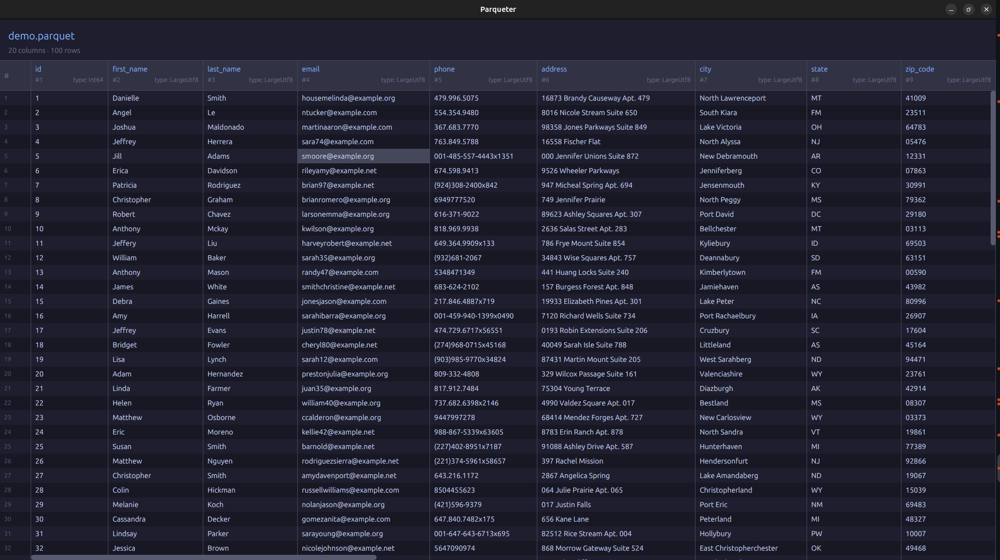

# Parqueter

# What's this project and how to use it
A fast, native Parquet file viewer built with Rust and [GPUI](https://github.com/zed-industries/zed/tree/main/crates/gpui) (the GPU-accelerated UI framework from the [Zed](https://zed.dev) editor team).

## Screenshot



## Install

### macOS and Linux

```bash
curl -fsSL https://raw.githubusercontent.com/clarityai-eng/parqueter/master/install.sh | sh
```

On macOS this installs `Parqueter.app` into `~/Applications`, so it shows up in Spotlight and Launchpad and can open `.parquet` files from Finder. It also links the `parqueter` command into `~/.local/bin`. On Linux it installs the `parqueter` binary into `~/.local/bin`.

To make Parqueter the default app for `.parquet` files: in Finder, select any `.parquet` file, open **Get Info** (Cmd+I), choose Parqueter under **Open with**, and click **Change All…**.

> **Why a script and not a DMG?** The app is not signed with an Apple Developer ID, so a browser download would trigger the "Apple could not verify…" Gatekeeper dialog. Files downloaded with `curl` are not quarantined, so the script avoids it.

### Windows

Download and run the `.msi` installer from [Releases](https://github.com/clarityai-eng/parqueter/releases) — or install from PowerShell:

```powershell
irm https://raw.githubusercontent.com/clarityai-eng/parqueter/master/install.ps1 | iex
```

The MSI installs to `%LocalAppData%\Programs\Parqueter` and adds it to your PATH. The PowerShell script installs the binary to `~\.local\bin`.

### Manual download

Take the latest build for your platform in [Releases](https://github.com/clarityai-eng/parqueter/releases).


# Development
## Requirements

- **Rust nightly** (GPUI requires unstable features)
- **Linux**: `libxkbcommon-dev`, `libxkbcommon-x11-dev`
- **macOS**: Xcode + command line tools
- **Windows**: Win32/DirectWrite

## Build & Run

```bash
# Install system dependencies (Linux)
sudo apt-get install -y libxkbcommon-dev libxkbcommon-x11-dev

# Build
cargo build --release

# Run
./target/release/parqueter path/to/file.parquet
```

On macOS without full Xcode (Command Line Tools only), GPUI cannot precompile its Metal shaders. Build with runtime shader compilation instead:

```bash
cargo build --release --features gpui_platform/runtime_shaders
```

To build the `.app` bundle locally: `scripts/bundle-macos.sh target/release/parqueter 0.0.0-dev target/bundle`

Note: file paths with spaces must be quoted: `./target/release/parqueter "path/to/my file.parquet"`

## Testing

**Run the tests before merging any change.** CI does not run them yet.

```bash
cargo test

# macOS without full Xcode
cargo test --features gpui_platform/runtime_shaders
```

- `data.rs` tests write small Parquet files to the temp dir and check reading, caching and formatting.
- `ui.rs` tests open the real view in GPUI's headless test window and drive it with simulated wheel, mouse and keyboard events. They need no display.
- Two `#[ignore]`d probes time reads against a real file:
  `PARQUETER_PROBE_FILE=/path/file.parquet cargo test --release probe -- --ignored --nocapture`

Add a test with every behaviour change. A useful check: break the code you just fixed and confirm a test fails.

## Keyboard Shortcuts

Cmd on macOS, Ctrl on Linux and Windows.

| Key | Action |
|-----|--------|
| Arrow keys | Move the selected cell; the view follows. The first press selects the top-left visible cell |
| Page Up/Down | Move one screen of rows |
| Home/End, Cmd+Left/Right | First/last column |
| Cmd+Up/Down, Cmd+Home/End | First/last row |
| Cmd+C (or Ctrl+C) | Copy selected cell to clipboard |
| Cmd+O (or Ctrl+O) | Open file picker |
| Double-click | Select cell + copy to clipboard |

## Architecture

```
src/
├── main.rs   — CLI argument parsing, GPUI app launch
├── data.rs   — DataSource trait, LazyParquetSource with LRU cache
└── ui.rs     — GPUI views, virtualized table rendering, scrollbars
```

**Key design decisions:**

- **`DataSource` trait** abstracts data access — the UI doesn't know if data comes from memory or disk
- **`LazyParquetSource`** reads 256-row chunks of one column at a time (row groups can span the whole file), keeps the decoded Arrow arrays in an LRU capped at 256 MB, and formats only the visible cells (truncated to what fits on screen; copying uses the full value)
- **Per-column sequential readers** — each column keeps its reader open after the last chunk, so scrolling forward does not re-scan from the start of the row group (matters for nested columns such as embeddings when the file has no page index)
- **Column virtualization** — only columns overlapping the viewport are rendered (typically 3-5 of 137)
- **Row virtualization** — only visible rows are rendered, positioned from an `f64` scroll offset (GPUI's `f32` loses whole pixels past ~600k rows)
- **Deferred loading during drag** — scrollbar dragging skips I/O for instant response, loads data after 100ms idle or on release

## License

MIT
