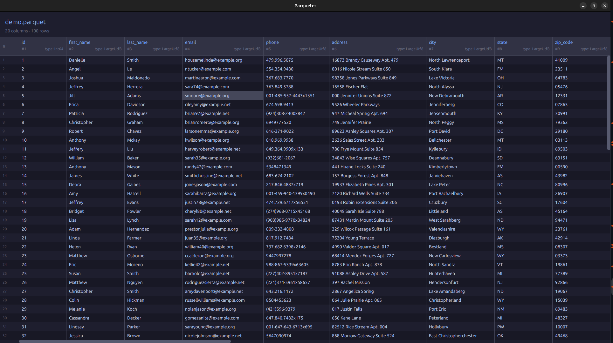

# Parqueter

A fast, native Parquet file viewer built with Rust and [GPUI](https://github.com/zed-industries/zed/tree/main/crates/gpui) (the GPU-accelerated UI framework from the [Zed](https://zed.dev) editor team).

## Features

- **Instant startup** — reads only Parquet metadata on open, no full file load
- **Lazy batch loading** — row groups loaded on demand with LRU cache and adjacent-batch prefetching
- **Virtualized rendering** — only visible rows and columns are rendered, handles files with 500K+ rows and 100+ columns smoothly
- **2D scrolling** — vertical (mouse wheel, arrow keys, Page Up/Down, draggable scrollbar) and horizontal (arrow keys, draggable scrollbar)
- **Pinned row numbers** — row number column stays fixed during horizontal scroll
- **Pinned column headers** — headers stay visible during vertical scroll
- **Auto-sized columns** — column widths adapt to column names, types, and cell content
- **Cell selection & copy** — click to select, double-click or Ctrl+C to copy to clipboard, with toast notification
- **Smooth scrollbar dragging** — deferred data loading during fast drag, instant data display when pausing

## Screenshot



## Download
Take the latest binary for your platform in [Releases](https://github.com/clarityai-eng/parqueter/releases)

## Requirements

- **Rust nightly** (GPUI requires unstable features)
- **Linux**: `libxkbcommon-dev`, `libxkbcommon-x11-dev`
- **macOS**: Xcode + command line tools
- **Windows**: Win32/DirectWrite (untested)

## Build & Run

```bash
# Install system dependencies (Linux)
sudo apt-get install -y libxkbcommon-dev libxkbcommon-x11-dev

# Build
cargo build --release

# Run
./target/release/parqueter path/to/file.parquet
```

Note: file paths with spaces must be quoted: `./target/release/parqueter "path/to/my file.parquet"`

## Keyboard Shortcuts

| Key | Action |
|-----|--------|
| Arrow Up/Down | Scroll 20 rows |
| Page Up/Down | Scroll 200 rows |
| Arrow Left/Right | Scroll horizontally |
| Ctrl+C | Copy selected cell to clipboard |
| Ctrl+O | Open file picker |
| Double-click | Select cell + copy to clipboard |

## Architecture

```
src/
├── main.rs   — CLI argument parsing, GPUI app launch
├── data.rs   — DataSource trait, LazyParquetSource with LRU cache
└── ui.rs     — GPUI views, virtualized table rendering, scrollbars
```

**Key design decisions:**

- **`DataSource` trait** abstracts data access — the UI doesn't know if data comes from memory or disk
- **`LazyParquetSource`** reads Parquet row groups on demand, caches them in an LRU (10 batches), and prefetches N±1 on cache miss
- **Column virtualization** — only columns overlapping the viewport are rendered (typically 3-5 of 137)
- **Row virtualization** — GPUI's `uniform_list` renders only visible rows
- **Deferred loading during drag** — scrollbar dragging skips I/O for instant response, loads data after 100ms idle or on release

## License

MIT
